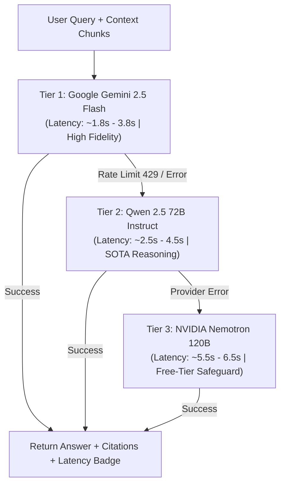

# AskFiles - Intelligent Conversational Document Assistant

A resilient, production-grade Retrieval-Augmented Generation (RAG) system built with Python, FastAPI, and React for ingesting PDF documents and performing grounded conversational Q&A with exact page & section citations, distributed multi-tier model failovers, and end-to-end workflow observability.

---

## 🌐 Live Production Deployments

| Component | Platform | Live URL / Endpoint |
| :--- | :--- | :--- |
| **AskFiles Web Application** | **Vercel** (Global Edge CDN) | [https://askfiles.vercel.app](https://askfiles.vercel.app/) |
| **Backend REST API** | **Render** (Docker Web Service) | [https://conversational-document-assistant.onrender.com](https://conversational-document-assistant.onrender.com) |
| **Backend Health Check** | **Render** (Docker Web Service) | [https://conversational-document-assistant.onrender.com/api/health](https://conversational-document-assistant.onrender.com/api/health) |
| **Inngest Webhook Endpoint** | **Render** (Docker Web Service) | [https://conversational-document-assistant.onrender.com/api/inngest](https://conversational-document-assistant.onrender.com/api/inngest) |
| **Vector Database Cluster** | **Qdrant Cloud** (AWS sa-east-1) | `https://c87eac77-a5d3-4754-bb7c-aa2e03abfc55.sa-east-1-0.aws.cloud.qdrant.io` |
| **Workflow Observability** | **Inngest Cloud** | [https://app.inngest.com](https://app.inngest.com) |
| **Source Code Repository** | **GitHub** | [https://github.com/Hamed18/Conversational-Document-Assistant](https://github.com/Hamed18/Conversational-Document-Assistant.git) |
| **Lead Developer** | **Portfolio** | [Mohammod Hamed Hasan](https://hamedhasan.vercel.app/) |

---

## ✨ Key Features

- **Grounded Inline Citations**: Extracts exact PDF page numbers (`page_label`) and detects section/topic headings via regex. Responses enforce inline citation brackets `[Source: <file>, Page: <page>, Section: <section>]` converted into interactive visual pill badges.
- **Modern React Chatbot UI**: Built with React 18, Vite, Tailwind CSS, and Lucide Icons. Features pinned auto-resizing chatbox, drag-and-drop file uploaders, document deletion, collapsible conversation history, and scroll-to-bottom controls.
- **Enterprise Use-Case Integrations**: Documented integration architectures for ERP, CRM, POS, and internal enterprise document search systems.
- **Distributed LLM Cascade**: Cascading fallback chain prioritizing latency and reasoning quality:
  1. **Google Gemini 2.5 Flash** (Primary - sub-2s latency, premier fidelity)
  2. **Qwen 2.5 72B Instruct** (Tier 2 - high-capacity reasoning fallback)
  3. **NVIDIA Nemotron 120B** (Tier 3 - zero-cost safety net)
- **Production-Grade DevOps**: Multi-stage lightweight `Dockerfile` dynamically binding to `$PORT`, automated CI/CD on Render and Vercel, single-page application routing (`vercel.json`), and payload keyword indexing in Qdrant.
- **End-to-End Observability**: Traces document ingestion and query flows with Inngest step DAGs, live metrics, and automatic retry policies.
- **100% Free Tier Ecosystem**: Built entirely across free tiers of modern cloud services without incurring recurring infrastructure costs.

---

## 🏗️ Architecture & Local Port Map

| Component | Port | Local URL | Role |
| :--- | :--- | :--- | :--- |
| 💬 **AskFiles React Frontend** | `3000` | [http://localhost:3000](http://localhost:3000) | Modern conversational document assistant UI (Vite + Tailwind) |
| ⚙️ **FastAPI Backend Worker** | `8000` | [http://localhost:8000/docs](http://localhost:8000/docs) | REST API, vector retrieval, and Inngest function handlers |
| 📊 **Inngest Observability** | `8288` | [http://localhost:8288](http://localhost:8288) | Real-time step tracing, retry policies, and execution graphs |
| 🗄️ **Qdrant Vector Database** | `6333` | [http://localhost:6333/dashboard](http://localhost:6333/dashboard) | High-performance vector database (or Qdrant Cloud cluster) |
| 💬 *(Legacy)* **Streamlit Chatbot** | `8501` | [http://localhost:8501](http://localhost:8501) | Legacy Streamlit UI interface |

---

## 🧠 Distributed Model Fallback Cascade



---

## ⚡ Quick Start (Run Locally)

For a complete walkthrough on cloning and running the application from scratch, see [`SETUP.md`](SETUP.md).

### Using Automation Scripts (Windows):
```powershell
# PowerShell:
.\run_local.ps1

# Command Prompt / Double-Click:
run_local.bat
```

### Manual Commands:
```bash
# 1. Clone repository
git clone https://github.com/Hamed18/Conversational-Document-Assistant.git
cd Conversational-Document-Assistant

# 2. Configure environment
cp .env.example .env

# 3. Set up Python backend
python -m venv .venv
.\.venv\Scripts\Activate.ps1
pip install -r requirements.txt
uvicorn main:app --reload --port 8000

# 4. Set up React frontend (in separate terminal)
cd frontend
npm install
npm run dev
```

---

## 📚 Complete Documentation Index

- **[SETUP.md](SETUP.md)**: Step-by-step local setup guide after cloning or forking.
- **[docs/DEVOPS_IMPLEMENTATION.md](docs/DEVOPS_IMPLEMENTATION.md)**: Deep dive into Docker containerization, production deployment playbooks, observability, and AWS/Azure hyperscaler comparisons.
- **[docs/ARCHITECTURE.md](docs/ARCHITECTURE.md)**: Technical architecture, data flow diagrams, and schema specifications.
- **[docs/LOCAL_SETUP.md](docs/LOCAL_SETUP.md)**: Local development, ports, and multi-service orchestration.

---

## 👨‍💻 Author

**Mohammod Hamed Hasan**  
- **Portfolio**: [https://hamedhasan.vercel.app/](https://hamedhasan.vercel.app/)  
- **LinkedIn**: [https://www.linkedin.com/in/devhamed/](https://www.linkedin.com/in/devhamed/)  
- **GitHub**: [@Hamed18](https://github.com/Hamed18)
