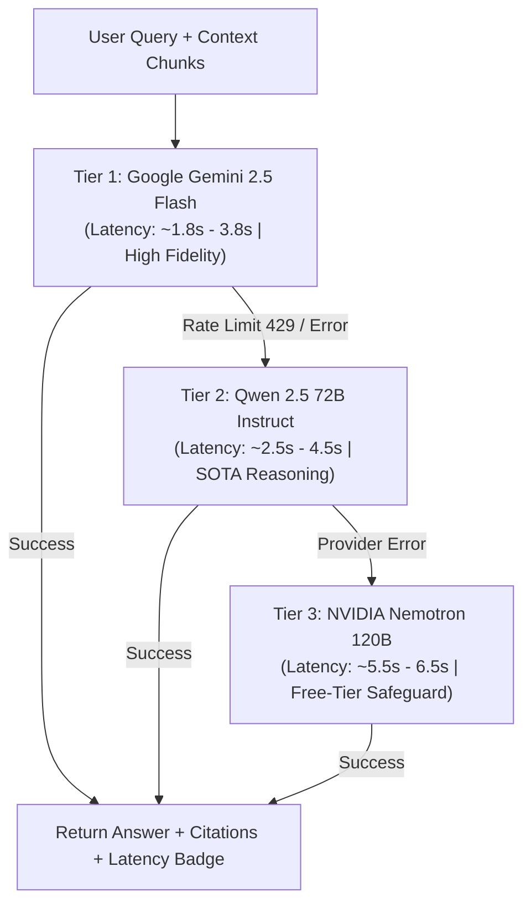

# Production-Ready RAG AI Document Reader Application

A resilient, production-grade Retrieval-Augmented Generation (RAG) system built in Python for ingesting PDF documents and performing grounded Q&A with citations, distributed multi-tier model failovers, and end-to-end workflow observability.

The application incorporates durability, distributed retries, rate limiting, and observability using **Inngest**, **Qdrant (Native & Docker)**, **LlamaIndex**, **OpenRouter Multi-Model Cascade (Gemini Flash, Qwen 2.5, Nemotron 120B)**, **FastAPI**, and **Streamlit**.

---

## 🏗️ Architecture & Local Port Map

| Component | Port | Local URL | Role |
| :--- | :--- | :--- | :--- |
| 💬 **Streamlit Chatbot** | `8501` | [http://localhost:8501](http://localhost:8501) | PDF uploader, conversational QA, model selector, latency badges |
| 📊 **Inngest Observability** | `8288` | [http://localhost:8288](http://localhost:8288) | Real-time step tracing, retry policies, and execution graphs |
| ⚙️ **FastAPI Backend Worker** | `8000` | [http://localhost:8000/docs](http://localhost:8000/docs) | Serves Inngest function endpoints & handles background workflows |
| 🗄️ **Qdrant Vector Database** | `6333` | [http://localhost:6333/dashboard](http://localhost:6333/dashboard) | High-performance vector database (3072-dim Cosine similarity) |

---

## 🧠 Distributed Model Fallback Architecture

To maximize response speed and ensure 100% uptime, queries utilize an intelligent 3-tier distributed model cascade prioritized by **Latency** and **Reasoning Quality**:



1. **Tier 1 (Primary): `google/gemini-2.5-flash`**
   - High instruction synthesis, massive context fidelity, sub-2-second latency.
2. **Tier 2 (Fallback 1): `qwen/qwen-2.5-72b-instruct`**
   - Leading open-weights reasoning model, high factual grounding.
3. **Tier 3 (Fallback 2): `nvidia/nemotron-3-super-120b-a12b:free`**
   - 120B parameter dense model providing a zero-cost fallback safety net.

*Every tier attempt is tracked as an individual step in the Inngest Dev Server dashboard.*

---

## ⚡ Quick Start (Run Locally)

We provide one-command automation scripts to launch all 4 services concurrently:

### Using PowerShell:
```powershell
.\run_local.ps1
```

### Using Windows Batch / Double-Click:
```cmd
run_local.bat
```

---

## 📋 Manual Step-by-Step Commands

To run each service individually in dedicated terminal windows:

### Step 1: Start Qdrant Vector Database
**Option A: Native Windows Binary (Recommended - No Docker Required):**
```powershell
.\qdrant_server\qdrant.exe
```

**Option B: Docker Compose:**
```powershell
docker compose up -d
```
> Verify Qdrant is running: `curl.exe http://127.0.0.1:6333`

---

### Step 2: Start FastAPI Backend
```powershell
.\.venv\Scripts\uvicorn.exe main:app --reload --port 8000
```
> Serves Inngest function handlers at `http://127.0.0.1:8000/api/inngest`.

---

### Step 3: Start Inngest Observability Dev Server
```powershell
npx inngest-cli dev -u http://127.0.0.1:8000/api/inngest --no-discovery
```
> Open **[http://localhost:8288](http://localhost:8288)** to view execution trees, step durations, and retries.

---

### Step 4: Start Streamlit Frontend
```powershell
.\.venv\Scripts\streamlit.exe run streamlit_app.py --server.port 8501
```
> Open **[http://localhost:8501](http://localhost:8501)** to chat with your PDFs.

---

## 🌐 Public Sharing via Cloudflare Quick Tunnels (Optional)

To generate free, secure public HTTPS URLs without opening router ports or providing credentials:

```powershell
# Public Chatbot URL
.\cloudflared.exe tunnel --url http://127.0.0.1:8501 --no-autoupdate

# Public Inngest Dashboard URL
.\cloudflared.exe tunnel --url http://127.0.0.1:8288 --no-autoupdate
```

---

## ⚙️ Environment Configuration (`.env`)

```env
# OpenRouter API Key
OPENROUTER_API_KEY=your_key_here
OPENROUTER_BASE_URL=https://openrouter.ai/api/v1

# Distributed Model Fallback Chain
MODEL_PRIMARY=google/gemini-2.5-flash
MODEL_FALLBACK_1=qwen/qwen-2.5-72b-instruct
MODEL_FALLBACK_2=nvidia/nemotron-3-super-120b-a12b:free
MODEL_FALLBACK_CHAIN=google/gemini-2.5-flash,qwen/qwen-2.5-72b-instruct,nvidia/nemotron-3-super-120b-a12b:free

# Compatible OpenAI Settings
OPENAI_API_KEY=your_key_here
OPENAI_BASE_URL=https://openrouter.ai/api/v1

# Qdrant Vector Database
QDRANT_URL=http://localhost:6333
QDRANT_COLLECTION=docs

# Inngest Dev Server Configuration
INNGEST_API_BASE=http://127.0.0.1:8288/v1
```

---

## 📖 Additional Documentation
Detailed documentation on architecture, setup options, and error recovery is available in [`docs/LOCAL_SETUP.md`](docs/LOCAL_SETUP.md).
