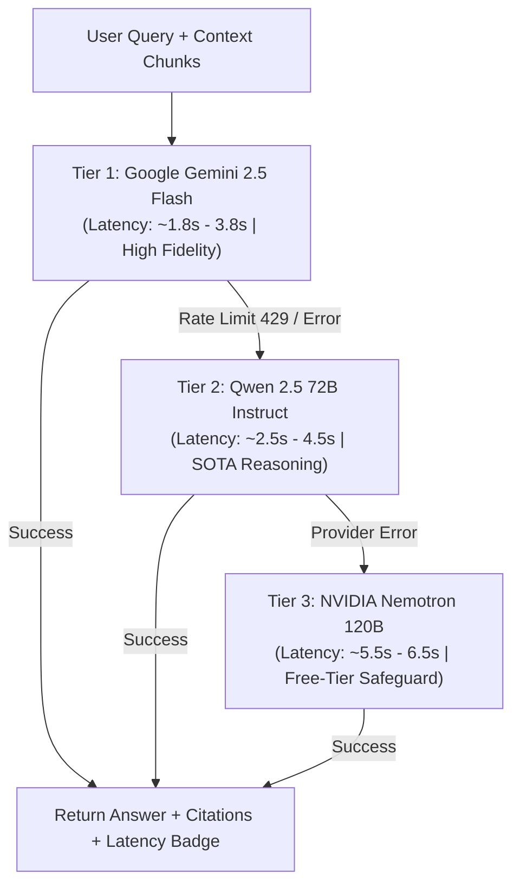

# Production-Ready RAG AI Document Reader Application

A resilient, production-grade Retrieval-Augmented Generation (RAG) system built in Python for ingesting PDF documents and performing grounded Q&A with citations, distributed multi-tier model failovers, and end-to-end workflow observability.

The application incorporates durability, distributed retries, rate limiting, and observability using **Inngest**, **Qdrant (Native & Docker)**, **LlamaIndex**, **OpenRouter Multi-Model Cascade (Gemini Flash, Qwen 2.5, Nemotron 120B)**, **FastAPI**, and **Streamlit**.

---

## 🏗️ Architecture & Local Port Map

| Component | Port | Local URL | Role |
| :--- | :--- | :--- | :--- |
| 💬 **Streamlit Chatbot** | `8501` | [http://localhost:8501](http://localhost:8501) | PDF uploader, conversational QA, model selector, latency badges |
| 📊 **Inngest Observability** | `8288` | [http://localhost:8288](http://localhost:8288) | Real-time step tracing, retry policies, and execution graphs |
| ⚙️ **FastAPI Backend Worker** | `8000` | [http://localhost:8000/docs](http://localhost:8000/docs) | Serves Inngest function endpoints & handles background workflows |
| 🗄️ **Qdrant Vector Database** | `6333` | [http://localhost:6333/dashboard](http://localhost:6333/dashboard) | High-performance vector database (3072-dim Cosine similarity) |

---

## 🧠 Distributed Model Fallback Architecture

To maximize response speed and ensure 100% uptime, queries utilize an intelligent 3-tier distributed model cascade prioritized by **Latency** and **Reasoning Quality**:



1. **Tier 1 (Primary): `google/gemini-2.5-flash`**
   - High instruction synthesis, massive context fidelity, sub-2-second latency.
2. **Tier 2 (Fallback 1): `qwen/qwen-2.5-72b-instruct`**
   - Leading open-weights reasoning model, high factual grounding.
3. **Tier 3 (Fallback 2): `nvidia/nemotron-3-super-120b-a12b:free`**
   - 120B parameter dense model providing a zero-cost fallback safety net.

*Every tier attempt is tracked as an individual step in the Inngest Dev Server dashboard.*

---

## ⚡ Quick Start (Run Locally)

We provide one-command automation scripts to launch all 4 services concurrently:

### Using PowerShell:
```powershell
.\run_local.ps1
```

### Using Windows Batch / Double-Click:
```cmd
run_local.bat
```

---

## 📋 Manual Step-by-Step Commands

To run each service individually in dedicated terminal windows:

### Step 1: Start Qdrant Vector Database
**Option A: Native Windows Binary (Recommended - No Docker Required):**
```powershell
.\qdrant_server\qdrant.exe
```

**Option B: Docker Compose:**
```powershell
docker compose up -d
```
> Verify Qdrant is running: `curl.exe http://127.0.0.1:6333`

---

### Step 2: Start FastAPI Backend
```powershell
.\.venv\Scripts\uvicorn.exe main:app --reload --port 8000
```
> Serves Inngest function handlers at `http://127.0.0.1:8000/api/inngest`.

---

### Step 3: Start Inngest Observability Dev Server
```powershell
npx inngest-cli dev -u http://127.0.0.1:8000/api/inngest --no-discovery
```
> Open **[http://localhost:8288](http://localhost:8288)** to view execution trees, step durations, and retries.

---

### Step 4: Start Streamlit Frontend
```powershell
.\.venv\Scripts\streamlit.exe run streamlit_app.py --server.port 8501
```
> Open **[http://localhost:8501](http://localhost:8501)** to chat with your PDFs.

---

## 🚀 Modern React Frontend & Cloud Architecture

In addition to the local Streamlit UI, the project includes a production-grade **React 18 Single Page Application (SPA)** with:
- **Pinned Bottom Chat Bar**: Auto-resizing textarea with keyboard shortcuts (`Enter` to submit, `Shift+Enter` for newline).
- **Left Sidebar**: Multi-session persistent chat history (stored locally), PDF Drag & Drop uploader, cascade model selector (`Gemini 2.5 Flash ➜ Qwen 2.5 72B ➜ Nemotron 120B`), and real-time cloud health status.
- **Rich Chat Stream**: Markdown formatting, syntax highlighting, model response badges with latency timing, and collapsible citation cards (`📚 Sources & Citations`).

---

## ☁️ Permanent Free Cloud Deployment Guide

This project is architected for zero-cost, permanent cloud hosting without ephemeral tunnels:

```
┌────────────────────────────────┐         ┌────────────────────────────────┐
│   Vercel Free Hosting          │         │   Render.com Free Web Service   │
│   React 18 + Vite Frontend     │ ──────> │   Dockerized FastAPI Backend    │
│   (Permanent HTTPS URL)        │  HTTPS  │   (Auto-scaling / Health Probe) │
└────────────────────────────────┘         └───────────────┬────────────────┘
                                                           │
                                   ┌───────────────────────┴───────────────────────┐
                                   ▼                                               ▼
                    ┌──────────────────────────────┐                ┌──────────────────────────────┐
                    │     Qdrant Cloud Free        │                │     Inngest Cloud Free       │
                    │   Managed Vector Cluster     │                │   Distributed Observability  │
                    │   (4GB Permanent Storage)    │                │   (50k runs/mo Tracing)      │
                    └──────────────────────────────┘                └──────────────────────────────┘
```

### 1. Backend Deployment (Render.com)
1. Sign up / Log in to [Render.com](https://render.com) (Free Tier).
2. Click **New +** ➜ **Web Service**.
3. Connect your GitHub repository: `Hamed18/Conversational-Document-Assistant`.
4. Choose **Docker** as the Environment.
5. In **Environment Variables**, add:
   - `OPENROUTER_API_KEY`: Your OpenRouter API key.
   - `OPENROUTER_BASE_URL`: `https://openrouter.ai/api/v1`
   - `QDRANT_URL`: `https://c87eac77-a5d3-4754-bb7c-aa2e03abfc55.sa-east-1-0.aws.cloud.qdrant.io`
   - `QDRANT_API_KEY`: Your Qdrant Cloud API key.
   - `QDRANT_COLLECTION`: `docs`
   - `INNGEST_SIGNING_KEY`: Your Inngest Cloud Signing Key (`signkey-prod-...`).
   - `INNGEST_EVENT_KEY`: Your Inngest Cloud Event Key.
   - `MODEL_FALLBACK_CHAIN`: `google/gemini-2.5-flash,qwen/qwen-2.5-72b-instruct,nvidia/nemotron-3-super-120b-a12b:free`
6. Click **Deploy Web Service**. Render will build the Docker container and provide a permanent HTTPS URL (e.g. `https://your-rag-backend.onrender.com`).

---

### 2. Connect Inngest Cloud Webhook
1. Open your [Inngest Cloud Dashboard](https://app.inngest.com).
2. Go to **Apps** ➜ **Add App / Webhook**.
3. Set the Webhook URL to: `https://your-rag-backend.onrender.com/api/inngest`.
4. Inngest Cloud will automatically synchronize your functions (`rag/pdf.ingest`, `rag/chat.query`) and begin recording live step-by-step traces.

---

### 3. Frontend Deployment (Vercel)
1. Sign up / Log in to [Vercel](https://vercel.com) (Free Tier).
2. Click **Add New...** ➜ **Project**.
3. Import `Hamed18/Conversational-Document-Assistant`.
4. In **Project Settings**:
   - **Root Directory**: Select `frontend` (Click Edit ➜ select `frontend`).
   - **Framework Preset**: `Vite` (automatically detected).
5. In **Environment Variables**, add:
   - `VITE_API_BASE_URL`: `https://your-rag-backend.onrender.com` (your Render backend URL).
6. Click **Deploy**. Vercel will build and provide your permanent public URL (e.g. `https://your-rag-app.vercel.app`).

---

## 💻 Local Development with React Frontend

Run both backend and frontend locally:

### Terminal 1: FastAPI Backend
```powershell
.\.venv\Scripts\uvicorn.exe main:app --reload --port 8000
```

### Terminal 2: React Dev Server
```powershell
cd frontend
npm install
npm run dev
```
> Open **[http://localhost:3000](http://localhost:3000)** in your browser. API requests are automatically proxied to `http://localhost:8000`.

---

## ⚙️ Environment Configuration (`.env`)

```env
# OpenRouter API Key
OPENROUTER_API_KEY=your_key_here
OPENROUTER_BASE_URL=https://openrouter.ai/api/v1

# Distributed Model Fallback Chain
MODEL_PRIMARY=google/gemini-2.5-flash
MODEL_FALLBACK_1=qwen/qwen-2.5-72b-instruct
MODEL_FALLBACK_2=nvidia/nemotron-3-super-120b-a12b:free
MODEL_FALLBACK_CHAIN=google/gemini-2.5-flash,qwen/qwen-2.5-72b-instruct,nvidia/nemotron-3-super-120b-a12b:free

# Qdrant Vector Database (Remote Cloud or Local)
QDRANT_URL=https://c87eac77-a5d3-4754-bb7c-aa2e03abfc55.sa-east-1-0.aws.cloud.qdrant.io
QDRANT_API_KEY=your_qdrant_api_key_here
QDRANT_COLLECTION=docs

# Inngest Cloud Configuration
INNGEST_SIGNING_KEY=signkey-prod-your_signing_key_here
INNGEST_EVENT_KEY=your_inngest_event_key_here
```

---

## 📖 Additional Documentation
- System Architecture & Data Flow: [`docs/ARCHITECTURE.md`](docs/ARCHITECTURE.md)
- Local Setup & Fallback Testing: [`docs/LOCAL_SETUP.md`](docs/LOCAL_SETUP.md)
