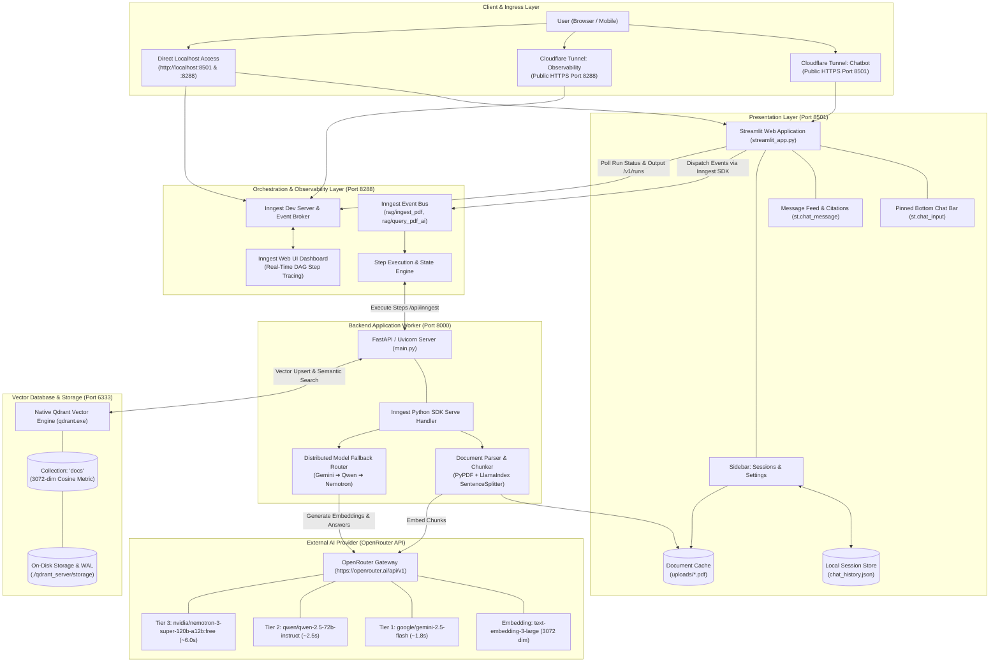
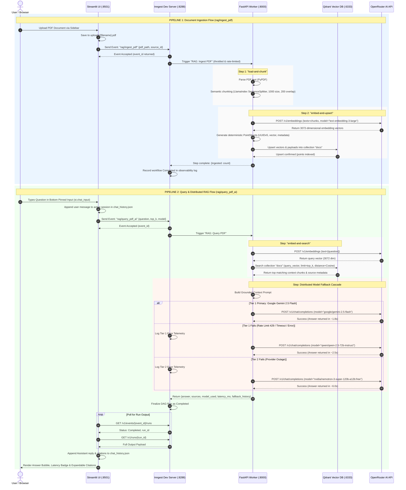

# System Architecture & Data Flow Documentation

This document provides architectural blueprints and end-to-end data flow diagrams for the **Conversational Document Assistant** RAG application.

---

## 1. System Architecture Diagram



---

## 2. End-to-End Data Flow Diagram (DFD)

The system manages two distinct asynchronous data pipelines:
1. **Document Ingestion Pipeline** (PDF Parsing, Chunking, Embedding, and Indexing)
2. **Query & Distributed RAG Pipeline** (Semantic Search, Context Assembly, Multi-Tier LLM Cascading, and Result Telemetry)



---

## 3. Data Transformations & Schemas

### A. Document Chunk & Embedding Schema
- **Chunk Size:** 1,000 characters with 200 characters semantic boundary overlap.
- **Embedding Vector:** 3,072-dimensional floating point dense vector (`text-embedding-3-large`).
- **Qdrant Point Payload:**
```json
{
  "id": "e6f47f20-96bc-5a4a-9eb6-0eb03a58e597",
  "vector": [0.0124, -0.0432, 0.0891, "...(3072 floats)"],
  "payload": {
    "source": "financial_report.pdf",
    "text": "In Q3 2026, total operating revenue reached $4.2B with a year-over-year increase of 14%..."
  }
}
```

### B. Inngest Event Schemas
- **Event: `rag/ingest_pdf`**
  ```json
  {
    "name": "rag/ingest_pdf",
    "data": {
      "pdf_path": "E:\\AI App\\Document Reader Application\\RAG App\\uploads\\contract.pdf",
      "source_id": "contract.pdf"
    }
  }
  ```
- **Event: `rag/query_pdf_ai`**
  ```json
  {
    "name": "rag/query_pdf_ai",
    "data": {
      "question": "What were the total revenues in Q3?",
      "top_k": 5,
      "model": "auto"
    }
  }
  ```

### C. Persistent Chat Session Schema (`chat_history.json`)
```json
{
  "active_session_id": "a1b2c3d4-e5f6-7890-abcd-ef1234567890",
  "sessions": {
    "a1b2c3d4-e5f6-7890-abcd-ef1234567890": {
      "id": "a1b2c3d4-e5f6-7890-abcd-ef1234567890",
      "title": "What were the total revenues in Q3?",
      "created_at": 1729267000.12,
      "messages": [
        {
          "role": "user",
          "content": "What were the total revenues in Q3?",
          "timestamp": 1729267001.0
        },
        {
          "role": "assistant",
          "content": "Total operating revenue in Q3 reached $4.2B, representing a 14% YoY growth.",
          "model_used": "google/gemini-2.5-flash",
          "latency_ms": 1807.76,
          "sources": ["financial_report.pdf"],
          "fallback_history": [],
          "timestamp": 1729267003.8
        }
      ]
    }
  }
}
```
